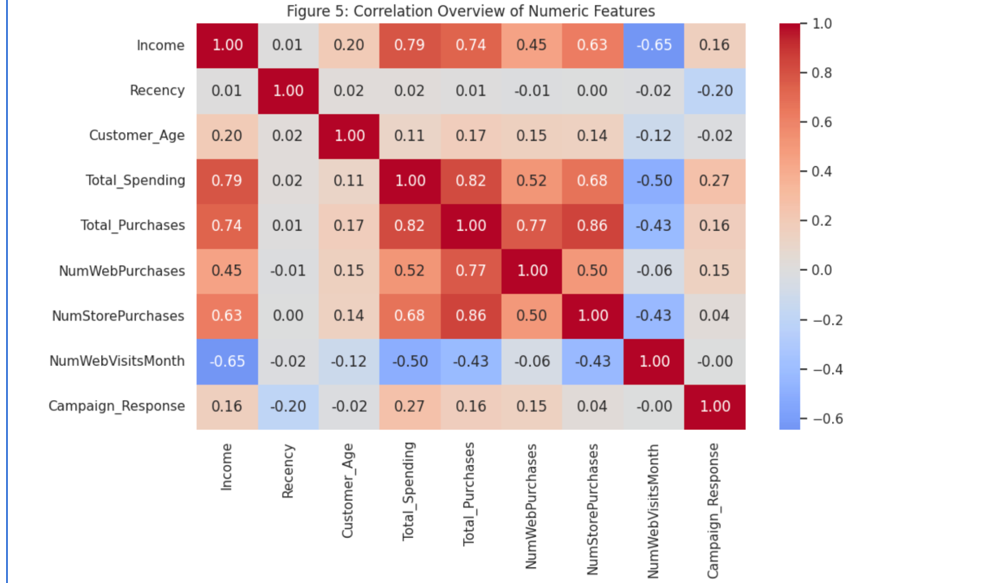
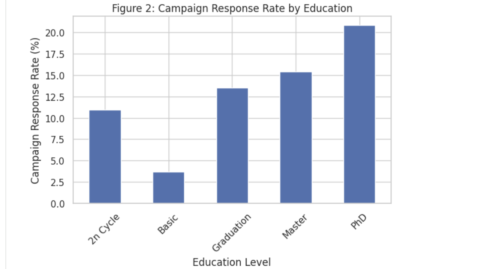
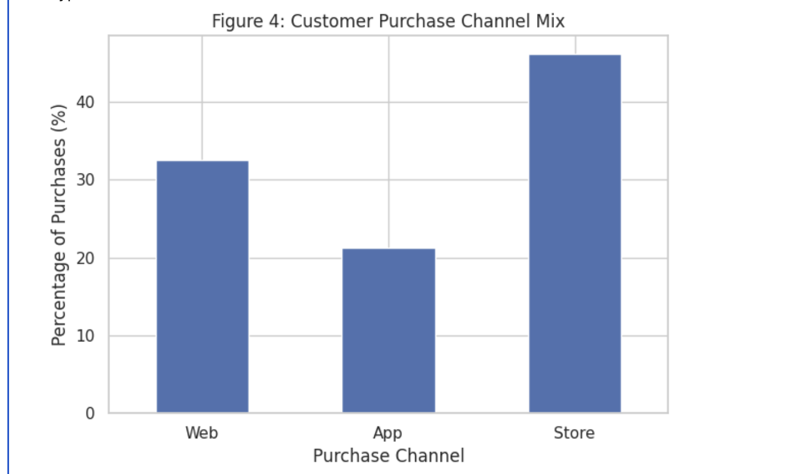
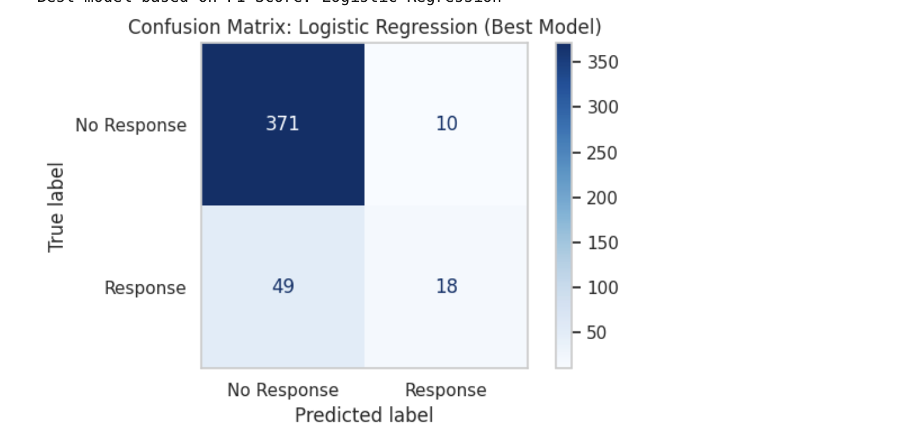

# Customer Response Prediction | Machine Learning

**Can machine learning identify customers most likely to respond to a marketing campaign?**

Analyzed **2,240 customer records** and compared three classification models using demographics, purchasing behaviour, and engagement history.

## Tech Stack

**Python · Scikit-learn · Pandas · NumPy · Matplotlib · Seaborn · Google Colab**

## Dataset Insights

- **14.9%** of customers responded to the campaign, creating an imbalanced classification problem.
- **Total spending** showed the strongest positive correlation with response among the numeric features analyzed (**r = 0.27**); **recency** had the strongest negative correlation (**r = −0.20**).
- **PhD customers** had the highest observed response rate (**20.8%**) across education categories.
- **46.2%** of purchases were made in-store, versus **32.6%** via web and **21.2%** via app.

## Machine Learning Results

Trained **Logistic Regression, Support Vector Machine (SVM), and K-Nearest Neighbors (KNN)** using an 80/20 stratified train-test split.

| Model | Test Accuracy | Test F1 |
| --- | ---: | ---: |
| Logistic Regression | 86.8% | **0.379** |
| SVM | **87.7%** | 0.353 |
| KNN | 85.7% | 0.347 |
| Majority-class baseline | 85.1% | 0.000 |

**Logistic Regression achieved the highest F1 score**, with **64.3% precision** and **26.9% recall**. Its confusion matrix highlights the difficulty of identifying positive responses in an imbalanced dataset.

